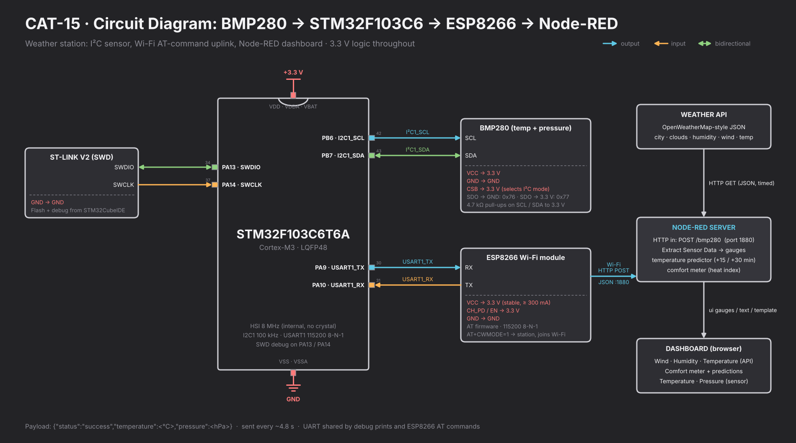
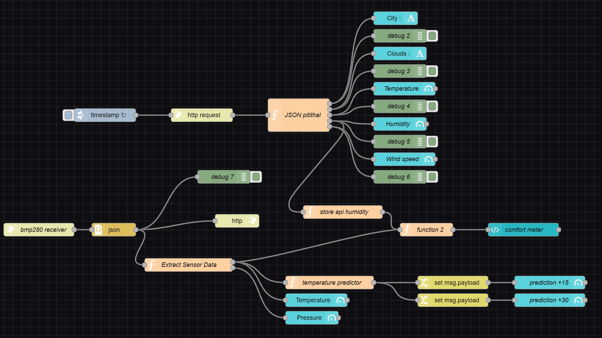
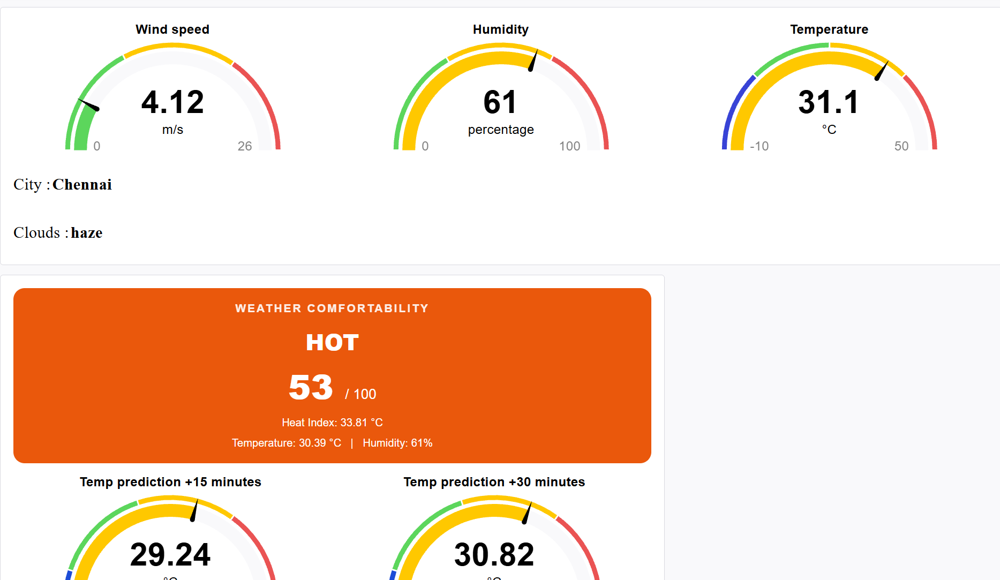
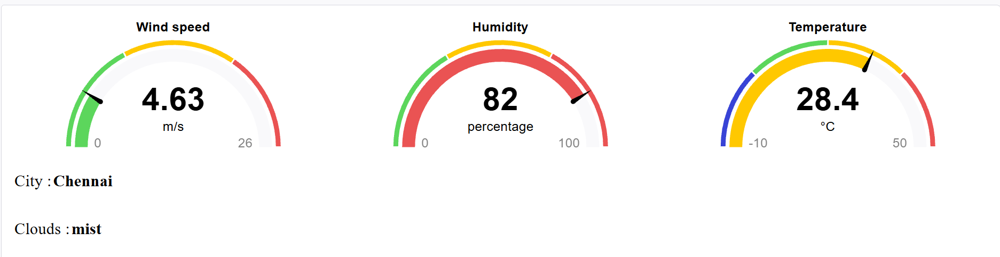
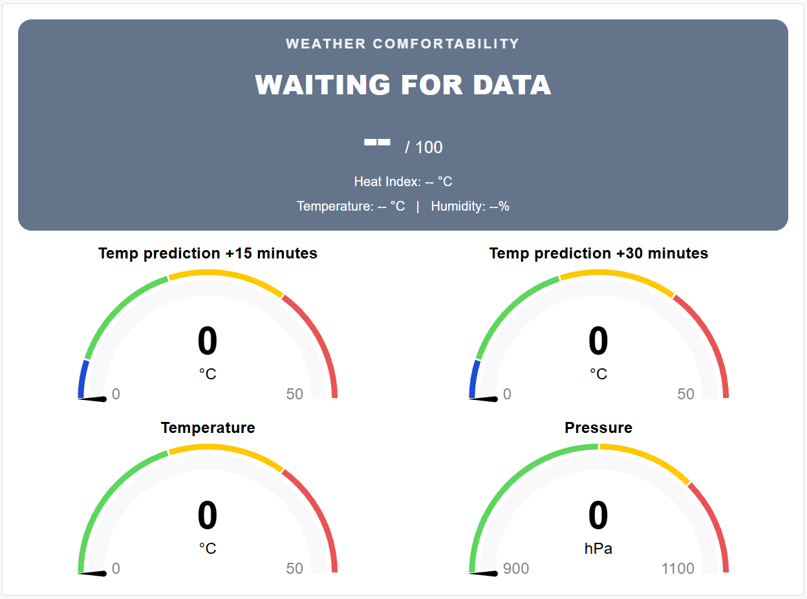

# EXPERIMENT DETAILS
**EXP:** CONTINUOUS ASSESSMENT 15
**DATE:** [11/11/2026]
**NAME OF EXP:** Sensor Interfacing (BMP280) - (HTTP) - Node-RED Analytics
**HARDWARE SETUP / PLATFORM:** STM32CubeMX + STM32CubeIDE (HAL) + STM32F103C6T6A development board + BMP280 sensor + ESP8266 Wi-Fi module + ST-LINK V2 + Node-RED (with node-red-dashboard)
---
## TASK 15A - BMP280 Sensor Interfacing Using I2C and HTTP POST (ESP8266)
### 1. Circuit Diagram
- Development board: STM32F103C6T6A (LQFP48), clocked from the internal 8 MHz HSI, 3.3V logic.
- PB6 (I2C1_SCL): connected to BMP280 SCL.
- PB7 (I2C1_SDA): connected to BMP280 SDA.
- BMP280 supply: 3.3V and GND (assumed). CSB tied to 3.3V for I2C mode and 4.7 kΩ pull-ups on SCL/SDA (assumed; most breakouts already include them).
- BMP280 address: SDO to GND gives 0x76, SDO to 3.3V gives 0x77. The firmware scans both.
- PA9 (USART1_TX): connected to ESP8266 RX.
- PA10 (USART1_RX): connected to ESP8266 TX.
- ESP8266 supply: 3.3V (assumed; the module needs a stable supply of about 300 mA or more) with CH_PD/EN tied to 3.3V (assumed).
- Common ground between STM32, BMP280 and ESP8266 (assumed).
- PA13 (SWDIO) and PA14 (SWCLK): connected to ST-LINK V2 for programming and debugging.
- HTTP target: Node-RED server, TCP port 1880, endpoint `POST /bmp280`.

### 2. Core Logic / Pseudocode / Code Base
**Working Principle:** The program initializes I2C1 and USART1, locates the BMP280 on the I2C bus, resets it, reads its calibration data and starts it in normal mode. It then initializes the ESP8266 through USART1 with AT commands and connects it to the configured Wi-Fi network. In an endless loop it reads the raw temperature and pressure registers, compensates them with the Bosch driver, prints the values on USART1 and sends them to Node-RED as a JSON body in an HTTP POST request: `{"status":"success","temperature":<°C>,"pressure":<hPa>}`. Humidity is not measured on the board.

**Pseudocode:**
1. Call `HAL_Init()` and configure the system clock (HSI, 8 MHz, no PLL).
2. Initialize GPIO, I2C1 (100 kHz) and USART1 (115200, 8-N-1).
3. Scan I2C addresses `0x76` and `0x77` with `HAL_I2C_IsDeviceReady()` and read the chip ID register `0xD0`; accept the device only if the ID is `0x58`.
4. If no sensor is found, send `BMP280 NOT FOUND!` on USART1 and halt.
5. Initialize the BMP280: soft reset (`0xE0 ← 0xB6`), wait 10 ms, read the 24-byte calibration block from `0x88`, set the filter off (`0xF5 = 0x00`) and set 1x temperature/pressure oversampling in normal mode (`0xF4 = 0x27`).
6. Initialize the ESP8266: `AT`, `AT+CWMODE=1` (station mode), `AT+CWJAP="<ssid>","<password>"`.
7. If the BMP280 initialization failed, send the error code on USART1 and halt.
8. Repeat forever: wait 100 ms, read 6 raw bytes from `0xF7`, compensate temperature and pressure with `bme280_compensate_data()`, convert pressure from Pa to hPa and print `Temperature | Pressure` on USART1.
9. Build the JSON payload, then run `AT+CIPSTART` (TCP to the Node-RED server, port 1880), `AT+CIPSEND`, transmit the HTTP POST request and run `AT+CIPCLOSE`.

**Code Base:** The `main.c` uses `HAL_Init()`, `SystemClock_Config()`, `MX_GPIO_Init()`, `MX_I2C1_Init()`, `MX_USART1_UART_Init()`, `HAL_I2C_IsDeviceReady()`, `HAL_I2C_Mem_Read()`, `HAL_I2C_Mem_Write()`, `HAL_UART_Transmit()`, `HAL_Delay()`, `I2C_HandleTypeDef hi2c1`, `UART_HandleTypeDef huart1`, and the user functions `BMP280_Read()`, `BMP280_Write()`, `BMP280_Read_Calibration()`, `BMP280_Init()`, `BMP280_Read_Data()`, `ESP_SendCommand()`, `ESP_Init()` and `ESP_SendReadings()`. Temperature and pressure compensation depends on the Bosch driver files `bme280.c`, `bme280.h` and `bme280_defs.h` (`bme280_compensate_data()`).

### 3. Inference
The program demonstrates register-level I2C acquisition from a BMP280 with Bosch compensation, together with UART-based control of an ESP8266 module that delivers the readings to Node-RED over HTTP, using only the HAL UART/I2C drivers and raw AT commands (no Arduino or ESP libraries). Each reading is delivered about every 4.8 seconds because every transmission opens and closes its own TCP connection. The sensor provides temperature and pressure only; humidity for the analytics must come from another source (see Task 15B).

### 4. Implementation Notes
- The firmware accepts only chip ID `0x58`, which identifies the BMP280 (temperature and pressure only). A true BME280 reports `0x60` and would be rejected. The project and the driver files carry the `bme280` name, but the code, comments and function names use `BMP280`.
- The Bosch BME280 driver is used only for compensation (`BME280_PRESS | BME280_TEMP`); the humidity field is set to 0.
- The BMP280 is configured for normal mode with 1x oversampling and the filter off (`0xF4 = 0x27`, `0xF5 = 0x00`).
- USART1 is used for both the debug text and the ESP8266 AT commands, so the debug lines are also received by the ESP8266.
- `ESP_Init()` is called before the BMP280 initialization result is checked, so the ESP8266 joins Wi-Fi even if the sensor initialization failed.
- One cycle contains blocking delays of 100 + 3000 + 1000 + 200 + 500 ms, which gives the roughly 4.8 s update interval. The ESP8266 initialization adds about 10 s once at start-up.
- The firmware stops in `while (1)` if the sensor is missing or its initialization fails.
- The Wi-Fi SSID, password and Node-RED server IP are hard-coded in `main.c`. Replace them with the intended network values and do not commit real credentials.
- The exact ESP8266 module/adapter model and its power arrangement are not specified in the source. The 3.3V supply, CH_PD/EN, common-ground, CSB/SDO and pull-up connections are marked assumed.
- The IOC configures I2C1 on PB6/PB7, USART1 on PA9/PA10 and SWD on PA13/PA14, matching `main.c`.

---
## TASK 15B - Node-RED Analytics and Dashboard
### 1. Flow Diagram
- Server: Node-RED with the node-red-dashboard package, listening on TCP port 1880.
- Input 1 (device): `bmp280 receiver` (http in) receives `POST /bmp280` from the ESP8266.
- Input 2 (weather API): `timestamp` (inject, repeating) triggers `http request`, which fetches the current weather for Chennai.
- Outputs: API gauges (Wind speed, Humidity, Temperature), text widgets (City, Clouds), sensor gauges (Temperature, Pressure), prediction gauges (+15 and +30 minutes) and the Weather Comfortability card.

### 2. Core Logic / Pseudocode / Code Base
**Working Principle:** Two independent flows feed one dashboard. The weather-API flow polls an online weather service on a timer, splits the JSON reply into city, cloud condition, temperature, humidity and wind speed, shows them on gauges and text widgets, and stores the API humidity. The device flow receives the ESP8266 packet, parses the JSON, replies to the ESP8266, and extracts temperature and pressure for their gauges. The temperature is also passed to a predictor that outputs the expected temperature after 15 and 30 minutes. A combining function joins the sensor temperature with the stored API humidity to compute a heat index and a comfort score out of 100, which the `comfort meter` template shows as a colour-coded card. Before the first packet arrives, the card shows `WAITING FOR DATA`.

**Pseudocode:**
1. Weather-API flow: the `timestamp` inject node fires repeatedly.
2. `http request` fetches the current weather JSON for the configured city.
3. `JSON pitithal` splits the reply into city, clouds, temperature, humidity and wind speed.
4. Update the `City :` and `Clouds :` text widgets and the `Temperature`, `Humidity` and `Wind speed` gauges.
5. `store api humidity` saves the humidity value for the comfort calculation.
6. Device flow: `bmp280 receiver` receives `POST /bmp280`; `json` parses the body and `http` sends the response back to the ESP8266.
7. `Extract Sensor Data` outputs temperature and pressure to the `Temperature` and `Pressure` gauges.
8. `temperature predictor` outputs the +15 and +30 minute predictions; each `set msg.payload` node routes one value to `prediction +15` or `prediction +30`.
9. `function 2` combines the sensor temperature with the stored API humidity, calculates the heat index and the comfort score, and sends them to `comfort meter`.

**Code Base:** The flow uses the nodes `inject` (`timestamp`), `http request`, `function` (`JSON pitithal`, `store api humidity`, `Extract Sensor Data`, `temperature predictor`, `function 2`), `http in` (`bmp280 receiver`), `json`, `http response` (`http`), `change` (`set msg.payload` x2), `ui_text` (`City :`, `Clouds :`), `ui_gauge` (`Temperature`, `Humidity`, `Wind speed`, `Temperature`, `Pressure`, `prediction +15`, `prediction +30`), `ui_template` (`comfort meter`) and `debug` (`debug 2` to `debug 7`). Gauge ranges: wind speed 0-26 m/s, humidity 0-100 %, API temperature -10 to 50 °C, sensor temperature and predictions 0-50 °C, pressure 900-1100 hPa.

**Dashboard Output:**

### 3. Inference
The dashboard confirms the complete path from the sensor to the browser. In the live capture the weather API reports 4.12 m/s wind, 61 % humidity and 31.1 °C for Chennai with haze, while the BMP280 reports 30.39 °C. The comfort card combines the sensor temperature with the API humidity and shows `HOT` with a heat index of 33.81 °C and a score of 53/100, and the prediction gauges show 29.24 °C at +15 minutes and 30.82 °C at +30 minutes. A second capture shows 4.63 m/s, 82 % and 28.4 °C with mist. Before any sensor packet has arrived, the comfort card shows `WAITING FOR DATA` and the gauges sit at their minimum, which separates "no data yet" from a real reading.

### 4. Implementation Notes
- Humidity comes from the weather API, not from the board, because the BMP280 has no humidity sensor.
- The exact weather service, URL and API key are not part of the supplied files. They are configured in the `http request` node and must be replaced with your own values; the key should not be committed.
- The function-node code for `temperature predictor` and `function 2` (prediction method and heat-index formula) and the exported flow JSON are not in the supplied files, so they are described here only at the level visible in the flow and the dashboard.
- Node names such as `JSON pitithal` are kept exactly as they appear in the flow.
- The `debug 2` to `debug 7` nodes are only for inspecting messages and do not affect the dashboard.
- The ESP8266 and the Node-RED server must be on the same network, and port 1880 must be reachable from the ESP8266.
- The dashboard is opened at `http://<server-ip>:1880/ui`.
- The experiment date is left as a placeholder (`[DD/MM/2026]`) because it is not stated in the supplied material.
